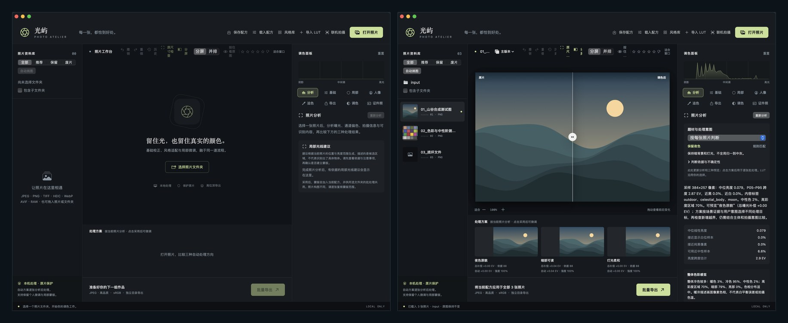
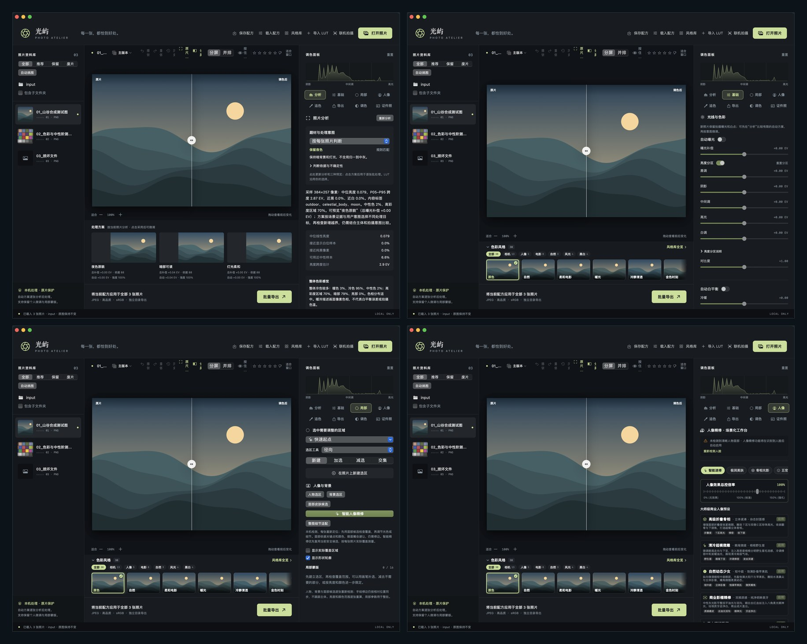
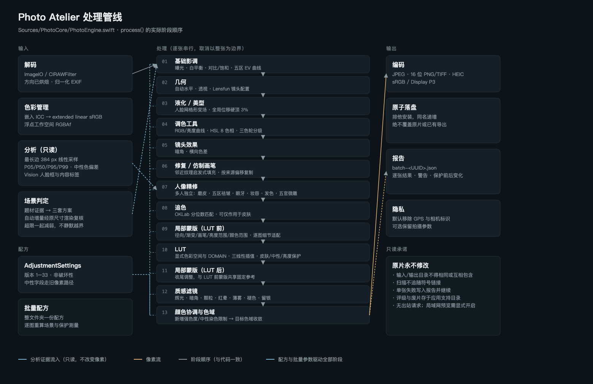
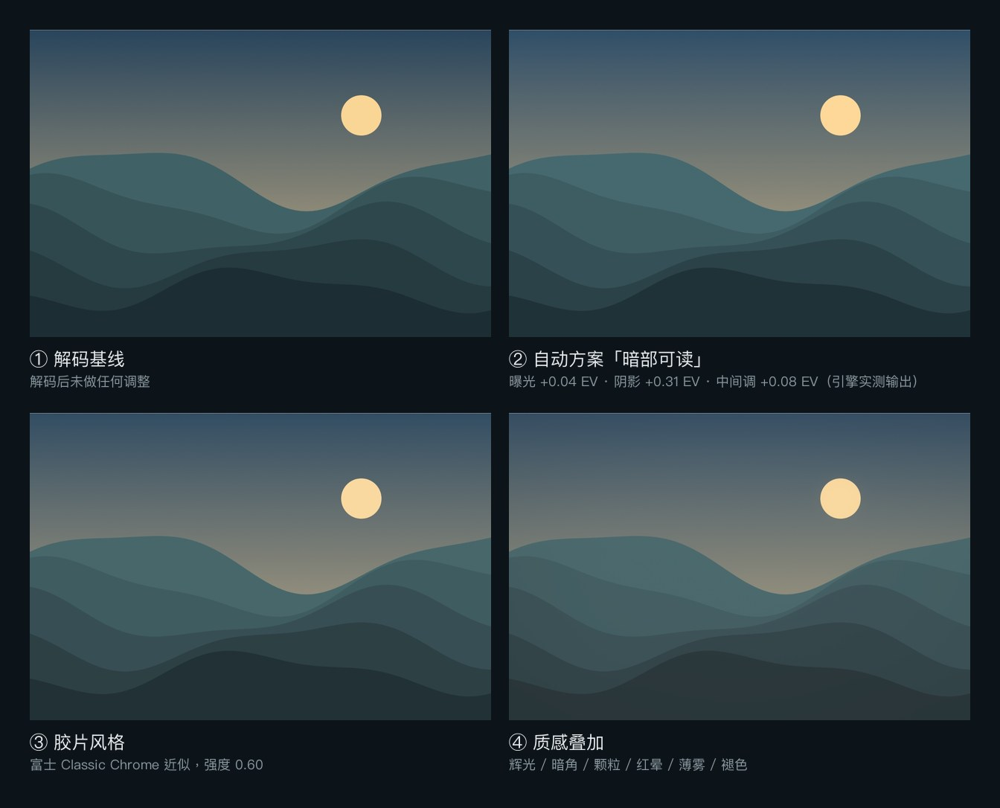
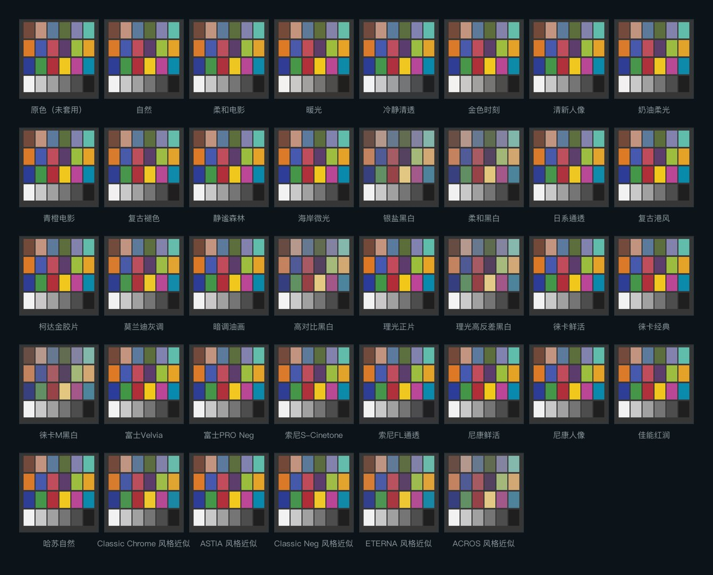
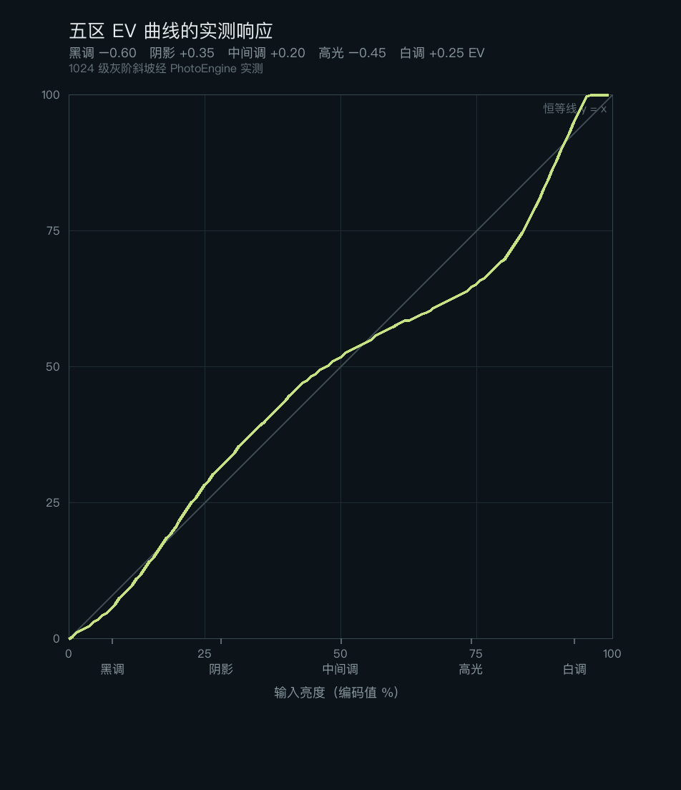
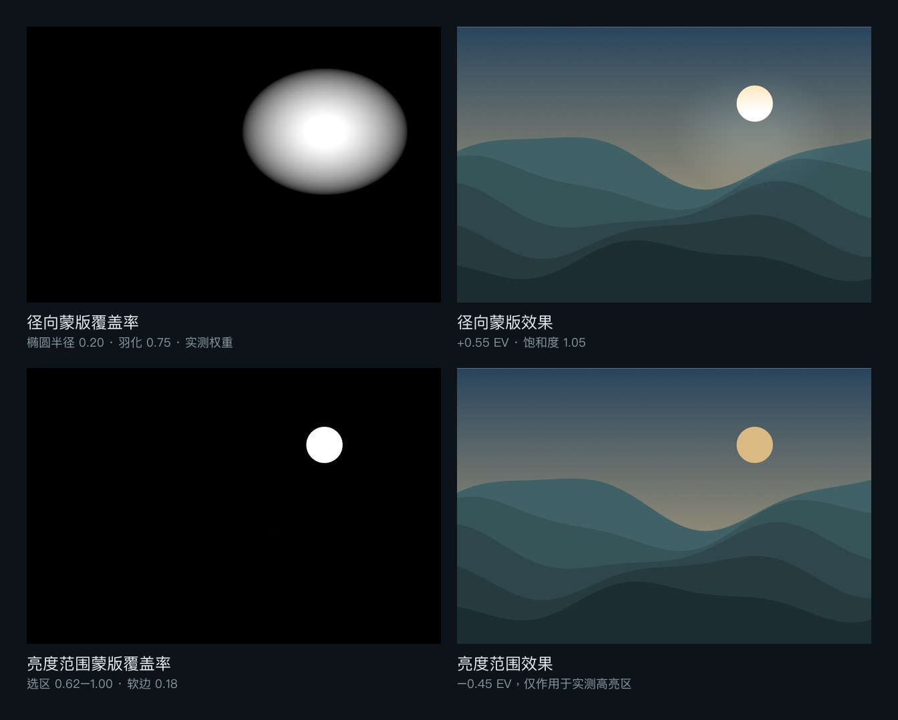

# 光屿 · Photo Atelier

面向 macOS 13 的**本地**照片分析与批量调色桌面应用。全部像素处理与内容识别在本机完成，不上传、不修改原片；应用自身不发起出站网络请求（唯一例外是用户显式开启的局域网交付预览，见「批量安全」）。

- **输入**：JPEG / PNG / 单页 TIFF / HEIC / HEIF / WebP / AVIF（后两者取决于本机 ImageIO 解码能力），以及本机 Apple RAW 解码器支持的相机 RAW。
- **实现**：Swift 5.8 + Core Image + Vision，Universal 原生双架构（x86_64 + arm64）；镜头校正依赖 Lensfun 0.3.4（948 相机 / 1304 镜头）。
- **验证**：838 个单元与回归测试（70 个测试套件），覆盖数值单调性、图像不变量、IO 边界、批处理与配方前向兼容。
- **约束**：非破坏性配方（保存版本 33，读取版本 1–33）、单边 ≤ 32768 px 且总像素 ≤ 120 MP、批量逐张串行、原子落盘不覆盖。

> **证据边界（先读）**：本仓库的自动化测试与本文配图证明的是**算法行为与工程不变量**，不是摄影画质或审美验收。真实照片的审美结论见 [P1-H 审美验收体系](docs/aesthetic-review-system.md) 与 [P2 人像自然度差距分析](docs/p2-face-naturalness-gap-analysis.md)；后者记录了一轮已完成的架构性返工与仍未收敛的项。

---

## 界面



左：照片资料库（评级 / 废片 / 自动挑图）。中：画布，支持分屏拖拽、并排 2-up、按住看原图、面部特写与五官定位。右：调色面板，按「分析 / 基础 / 局部 / 人像 / 追色 / 导出 / 调色 / 证件照」分页。



截图来自 `Scripts/ui_smoke.sh` 的真实窗口捕获（合成夹具，1200×950 窗口）。这是**渲染与存活性冒烟测试**，不覆盖滑杆、曲线编辑、笔刷、对话框与批量导出等交互路径。

---

## 处理管线



`PhotoEngine.process` 的实际阶段顺序（[PhotoEngine.swift:483](Sources/PhotoCore/PhotoEngine.swift#L483)）。图中的顺序即代码顺序，包括一处**已接受的偏差**：P0 遗留管线把基础影调放在几何之前，重排会改变 v1–v10 全部配方的像素输出，因此保留并在源码注释中记录，而非按设计文档的理想顺序实现。

三个设计约束贯穿全部阶段：

| 约束 | 含义 |
|---|---|
| **中性即旁路** | 每个可选阶段有 `isNeutral`；中性或缺失的设置整段跳过，旧配方的像素路径保持逐位一致 |
| **证据只读** | 分析（384 px 线性采样、Vision 标签与人脸框）只产生参数与说明，绝不直接改像素 |
| **保护可测量** | 皮肤 / 中性色 / 亮度保护以本图实测基准为准，无脸时不做颜色启发式替代 |

---

## 功能地图

### 影调与色彩



同一张合成夹具的四段实测输出，用于说明阶段边界：自动方案只做**基础影调**（本例中引擎按证据选了「暗部可读」：曝光 +0.04 EV、阴影 +0.31 EV、中间调 +0.08 EV），胶片风格在其上叠 LUT，质感叠加再叠着色器。这四步是可分离的，关掉后一步不会回滚前一步。

| 能力 | 实现要点 |
|---|---|
| 基础影调 | 线性光曝光乘法、五区 EV（黑调 / 阴影 / 中间调 / 高光 / 白调），相邻分区受单调曲线约束，纯黑不凭空恢复 |
| 调色工具 | RGB 与亮度曲线、HSL 8 色相、阴影/中间调/高光三色轮、镜头暗角与横向色差 |
| 风格库 | 32 款程序化原创 3D LUT（17³ 表）+ 5 款署名富士风格近似（Classic Chrome / ASTIA / Classic Neg / ETERNA / ACROS，33³ 表），按相机/人像/电影/自然/风光/黑白分类 |
| 逐图 LUT 适配 | 人脸皮肤候选与题材候选 → 测量实际明暗与色相 → 试渲染 9 组强度/保护组合 → 按约束选优并报告理由 |
| 追色 | OKLab 分位数匹配，可仅作用于皮肤；无参考或强度为 0 时不改图 |
| 质感滤镜 | 辉光、暗角、颗粒、胶片红晕（halation）、黑柔薄雾（mist）、褪色（fade）、银盐留银（bleach bypass），全部 GPU 着色器，在 LUT 之后 |
| 颜色协调 | 在全部叠加之后限制新增强色度、中性染色与突兀色相，按目标 sRGB / Display P3 的 SDR 边界收敛 |



上图为风格库全部 37 项（32 款原创 + 5 款富士近似）在**同一张合成色卡**上按各自推荐强度的真实渲染（`Scripts/render_readme_figures.swift` 生成）。它证明目录一致性与渲染路径可用；色卡不能代表实拍色彩表现，黑白类在推荐强度下仍保留部分原色是有意的强度混合结果。



1024 级灰阶斜坡经引擎实测的传递函数（黑调 −0.60 / 阴影 +0.35 / 中间调 +0.20 / 高光 −0.45 / 白调 +0.25 EV）。曲线在高光端压平、暗部抬升，单调性成立且无反转。原始采样数据随脚本输出 `tone-curve.json`，可复算。

### 局部与蒙版



上排：径向蒙版的**实际覆盖率**（灰度）与作用于照片的效果。下排：亮度范围蒙版（0.62–1.00、软边 0.18）——选区由实测像素决定，因此只命中太阳与亮部天空，与几何位置无关。

- 五种选区：径向、渐变、画笔、亮度范围、颜色范围；支持加选、减选、交集修边。
- 亮度/颜色范围始终取自**全局校正与几何之后、局部与 LUT 之前**的固定参考，避免选区随自身调整漂移。
- 局部校正默认位于 LUT 之前；`.afterLook` 蒙版用于收尾，两者共享同一参考。
- 逐图细节适配在有效覆盖内取参考像素，噪点估计歧义或样本不足时保守停用。
- 覆盖检查与建议是数据，不是自动改图：点击建议只会建立可编辑蒙版。

### 人像

「人像」页把能力收敛为 6 个场景页签下的 20 个独立模块，每张卡片支持单击旁路、按住瞬时对比、单模块复位；「智能速修」另提供 0–150% 总控倍率与 5 个商业人像预设。**写入配方的只有滑杆与预设**——模块旁路与总控倍率是预览会话状态，关掉应用即回默认。

| 页签 | 模块 |
|---|---|
| 智能速修 | 总控倍率、大师预设、活跃效果 HUD |
| 极润美肤 | 质感磨皮、五区祛皱与去油光、肤色统一、身体与手部美肤 |
| 骨相光影 | 全脸骨相立体光影、太阳穴/颧骨轮廓、下颌角/下巴 |
| 五官微雕 | 鼻部、眉形、眼型、双眼皮与卧蚕、眼神光/去反光/牙齿、微笑嘴角与唇形 |
| 美妆秀发 | 彩妆、秀发柔顺与发缝、发色统一与白发消除、唇毛胡青与特征痣 |
| 身形服饰 | 全身身形与骨骼点塑形、衣物平整祛皱、全景景深虚化 |

另有液化（7 种脸型预设 + 9 组解剖学滑杆 + push/重建/平滑画笔）、修复与仿制画笔、多人脸分组独立精修（最多 8 张脸，按 Vision 地标与颜色聚类，可手工修正角色）、证件照与换背景。

**几何形变的硬约束**：人脸网格 128×128、高斯控制点、pull-remap，全局位移上限为图像边长的 3%（[LiquifyWarp.swift:103](Sources/PhotoCore/LiquifyWarp.swift#L103)）。液化改变几何，因此修改后既有蒙版需复核。

**自然度的已知问题**：2026-11-12 的评审认定 6 个"涂色"模块是盲模板（固定位置、固定高光色），在架构上无法自然；R1–R11c 已完成止血与重构（光向估计、从照片导出色调、D&B 替代加色、蒙版几何修正、肤色分轴容差），但 R11c 明确指出**仍不完整**：部分区域的保护率仍非 100%，真正的解法是身体/头发分割而非继续放宽颜色窗口。逐条证据见 [P2 差距分析](docs/p2-face-naturalness-gap-analysis.md)。

### 批量、库与交付

| 能力 | 说明 |
|---|---|
| 资料库 | 0–5 星与废片标记、按全部/推荐/保留/废片筛选、启发式自动挑图；结果持久化到应用支持目录，原片不动 |
| 虚拟副本 | ⌘N 派生无限版本，零额外磁盘开销，独立保存调整与 LUT，跨会话持久化 |
| 选择性同步 | 37 个细粒度模块开关、4 套工作流预设、默认排除局部笔刷与蒙版，⌘Z 原子撤销 |
| 导出 | JPEG / 16 位 PNG·TIFF / HEIC，sRGB 或 Display P3，尺寸与文件名模板，水印（可同时输出无水印副本） |
| 交付页 | 3 款主题、静态 HTML 相册 + 接触表 PDF、离线隐私审计 `privacy-audit.json`、局域网 HTTP 手机预览 |
| 联机拍摄 | 影棚热文件夹实时监视，落盘平稳性检测后自动应用当前配方 |
| 并发 | 批量导出 1–8 路（默认 4），`ParallelBatch` 使用结构化并发，无锁无阻塞 |

---

## 分析与判据

分析采用**最长边 384 像素的线性 RGB 采样**，报告 P05/P50/P95/P99、近黑与近显示白比例、亮度跨度、饱和度与可靠中性样本的通道偏差。它是对**解码图像**的测量，不能证明拍摄曝光本身错误，也不能恢复已经丢失的信息。

- **场景判定**：题材证据（像素统计 + 可信 Vision 标签）给出人像 / 风光 / 夜景 / 逆光 / 高调 / 暗调 / 柔雾 / 黑白 / 保留风格，再生成三套方向（平衡 / 明亮 / 柔和）。无法可靠判定时保守回退。
- **自动增量检查**：候选参数先在**当前输入分辨率**的基础渲染上判定，新增 SDR 参考越界与黑位/负通道比例超过 0.5% 门槛即整体减弱。门槛受浮点统计精度影响，且不含后续手调、LUT 与局部叠加。
- **置信度**：`confidence` 是规则支持度，不是题材正确率，也不是审美评分。
- **白平衡**：三方案沿用用户的白平衡模式，不根据近灰像素自行中和。JPEG 通常没有可信的拍摄 Kelvin，不能从成片 RGB 反推；RAW 解码器给出的白点温度标为**解码器估计**。
- **RAW**：`CIRAWFilter` 全分辨率解码，保留 as-shot 白点与相机基准曝光，关闭额外曝光补偿、曲线与镜头校正，不把内嵌 JPEG 当作完整 RAW。不支持的相机或变体明确报错并隔离。

---

## 色彩与几何约定

- **工作空间**：嵌入 ICC 的输入经系统色彩管理进入 extended linear sRGB 浮点；输出按指定 ICC 转换并嵌入 sRGB / Display P3。
- **LUT 契约**：查表前显式转换原色、编码与 DOMAIN，查表后反编码；使用三线性插值保持源表节点。支持 sRGB、线性 sRGB、Display P3 + sRGB 曲线、Rec.709 primaries + Gamma 2.4、Rec.709 摄像机 OETF——后两者分开选择。`.cube` 限标准 RGB 三列、2–128 阶、完整行数与有限数值；不接受 1D/shaper、alpha 第四列或未声明指令。**仅接受输入输出为同一 RGB 空间、同一传递函数**的创意 LUT；Log、ACES、HDR 与跨色域变换不能只改一个选项后直接使用，也不从文件名猜测用途。
- **皮肤保护**：无检测到人脸时不启用颜色启发式——实测固定规则会在暖色夕阳或秋景上命中大半个画面。有脸时从本图皮肤蒙版测量基准，两个轴各自带容差（`(r−g)/L` 上限 0.18、`(g−b)/L` 上限 0.10），并按该轴四分位距自适应。多张脸时逐脸测量，不把一张脸的明暗切成两个色调。
- **蒙版几何**：肤色蒙版由 `skinOvalPolygon` 闭合 Vision 的开放下颌弧并补额头帽；两份实现（`FaceSemanticAnalyzer` 与 `ContentSelection`）必须一致，差异由测试守住。
- **几何校正**：自动水平用系统地平线检测，不可靠时跳过；旋转与透视安全裁切，保持原画布尺寸，不填充生成内容。Lensfun 只用于畸变与安全缩放，未启用暗角与横向色差校正；自动匹配遇到多个候选时跳过而非任选。

---

## 批量安全与数据完整性

- 输入、输出目录不得相同或互相包含；扫描不追随符号链接；每个输出检查路径边界。
- 逐张串行处理限制内存；单张失败写入报告并继续；取消以完整单张为边界，已完成结果保留。
- 临时编码完成后以**排他原子操作**安装文件，同名文件递增命名，绝不覆盖原片或已有导出。
- 输出目录生成 `batch-<UUID>.json`：不可变配方快照、逐张结果、校正报告、警告、颜色分布、保护前后变化与 LUT 表格诊断。清单无法更新时明确报错，不静默丢失。
- 默认移除 GPS 与相机标识；关闭时选择性保留拍摄参数，仍重写尺寸、方向与色彩信息，避免沿用旧缩略图或 ICC。
- 仅处理单页静态照片；多页 TIFF、动画 PNG 与 HEIC 序列明确拒绝。
- 应用**不发起任何出站网络请求**（「理光风格」条目里的外链是用户主动点击的系统浏览器链接）。例外是「客户交付页」的手机预览：用户显式开启后，本机会在端口 8080–8090 起一个 HTTP 服务，绑定 `INADDR_ANY`，因此**同一局域网内的其他设备可访问**，关闭页面即停止。这是设计上的局域网预览，不是公网服务，但共享网络下需自行判断是否开启。

---

## 构建与运行

```bash
python3 Scripts/prepare_lensfun.py     # 固定版本 + SHA-256，只写 .dependencies
make check                             # 编译 + 838 项测试
make app                               # Universal 双架构 .app
open build/PhotoAtelier.app
```

首次准备依赖需要网络；之后构建与运行完全离线。生成的 `build/PhotoAtelier.app` 可复制到「应用程序」，包内自带镜头数据库与动态库，不需要 Python 运行时。主可执行文件为 Universal（x86_64 + arm64）；Lensfun 依赖库为 x86_64，在 Apple Silicon 上经 Rosetta 2 协同运行。应用使用本地临时签名，**未经过 Apple 公证**。

| 命令 | 作用 |
|---|---|
| `make build` | 编译与类型检查 |
| `make test` | 数值、图像、IO、批处理回归 |
| `bash Scripts/build_app.sh` | Release `.app` 与签名验证 |
| `bash Scripts/ui_smoke.sh` | 窗口级 UI 冒烟（需已构建 app，需辅助功能权限） |
| `swift Scripts/make_demo.swift artifacts/demo/input --include-broken` | 生成合成夹具 |

### 复现本文配图

配图由脚本从真实引擎渲染，不手工绘制：

```bash
make build                              # 先生成 PhotoCore 目标文件
swift Scripts/make_demo.swift artifacts/demo/input --include-broken
BIN=.build/x86_64-apple-macosx/debug
swiftc -O -I "$BIN" -I "$BIN/CLensfunBridge.build" Scripts/render_readme_figures.swift \
  "$BIN"/PhotoCore.build/*.o "$BIN"/CLensfunBridge.build/CLensfunBridge.c.o \
  -o /tmp/render_readme_figures
/tmp/render_readme_figures /tmp/readme-raw
python3 Scripts/render_readme_figures.py /tmp/readme-raw artifacts/p3-verify/ui-smoke docs/images
python3 Scripts/draw_pipeline_figure.py docs/images
```

界面截图来自 `bash Scripts/ui_smoke.sh` 的输出目录（`artifacts/` 不入库）；没有该目录时合成脚本会跳过界面图并说明原因，其余配图照常生成。管线图由 `Scripts/draw_pipeline_figure.py` 生成 SVG 后用无头 Chrome 栅格化。

**配图只用合成夹具**，因此不含任何用户照片。这是有意的：真实样片按 [P1-H 规范](docs/aesthetic-review-system.md) 外部只读引用、不入库。代价是这些图只能证明管线行为，不能证明实拍画质。

---

## 已知边界

| 项 | 状态 |
|---|---|
| 真实照片审美验收 | 13 张样片完成端到端评测，评分是人工 1–5 分记录，不是统计意义上的准确率 |
| 人像自然度 | R1–R11c 已修架构性缺陷；剩余项（身体/头发分割缺失导致的保护不均）未解决 |
| 合成测试与实拍画质 | 合成夹具只用于重复验证，**不代表**真实相机画质 |
| RAW 高光重建 | 未实现专用高光重建、去马赛克选型或 AI 降噪；不分析 Bayer/X-Trans 逐感光单元电平 |
| 性能基准 | 24MP（6000×4000）与 ~45MP（8192px）基准在合成语料上测得，未覆盖全部真实机型组合 |
| 交互自动化 | UI 冒烟覆盖启动、导入、页签切换、滚动与截图；滑杆、曲线、笔刷、拖放、批量导出与对话框未自动化 |
| 公证与分发 | 本地临时签名，未公证 |
| 镜头校正 | 映射上限 40 MP，超出时保留照片、跳过校正并写警告 |

---

## 文档索引

**算法与规范**
[场景策略](docs/scene-adaptive.md) · [自动增量检查](docs/automatic-safety.md) · [五区亮度](docs/targeted-tones.md) · [局部建议复测](docs/local-guidance.md) · [蒙版操作](docs/masks.md) · [颜色协调](docs/color-harmony.md) · [胶片风格与逐图适配](docs/adaptive-film-luts.md) · [风格与滤镜](docs/style-effects.md) · [逐图细节适配](docs/adaptive-detail.md) · [原尺寸局部检查](docs/native-inspection.md) · [人像精修](docs/portrait-refinement.md) · [人像局部采样](docs/portrait-aware-refinement.md)

**验收与差距**
[审美验收体系](docs/aesthetic-review-system.md) · [P2 人像自然度差距分析](docs/p2-face-naturalness-gap-analysis.md) · [与商业产品的差距矩阵](docs/pixelcake-gap-analysis.md) · [开源调研与采用边界](docs/opensource-research.md) · [早期验证报告](docs/validation.md)

**交付批次**
[P0](docs/p0-release-notes.md) · [P1](docs/p1-release-notes.md) · [P1-B](docs/p1b-release-notes.md) · [P1-C](docs/p1c-release-notes.md) · [P1-D](docs/p1d-release-notes.md) · [P1-E](docs/p1e-release-notes.md) · [P1-F](docs/p1f-release-notes.md) · [P1-G](docs/p1g-release-notes.md) · [P1-H](docs/p1h-release-notes.md) · [P1-I](docs/p1i-release-notes.md) · [P2-A](docs/p2a-release-notes.md) · [P2-B](docs/p2b-release-notes.md) · [P2-C](docs/p2c-release-notes.md) · [P2-D](docs/p2d-release-notes.md) · [P2-E](docs/p2e-release-notes.md) · [P2-F](docs/p2f-release-notes.md) · [P2-G](docs/p2g-release-notes.md) · [P2-H](docs/p2h-release-notes.md) · [P2-I](docs/p2i-release-notes.md) · [P2-J](docs/p2j-release-notes.md) · [P2-K](docs/p2k-release-notes.md) · [P2-L](docs/p2l-release-notes.md) · [P2-M](docs/p2m-release-notes.md) · [P2-N](docs/p2n-release-notes.md) · [P2-O](docs/p2o-release-notes.md) · [P2-P](docs/p2p-release-notes.md) · [P2-Q](docs/p2q-release-notes.md) · [P2-R](docs/p2r-release-notes.md) · [P2-S](docs/p2s-release-notes.md) · [P2-T](docs/p2t-release-notes.md) · [P2-U](docs/p2u-release-notes.md) · [P2-V](docs/p2v-release-notes.md) · [P2-W](docs/p2w-release-notes.md) · [P2-X](docs/p2x-release-notes.md) · [P2-Y](docs/p2y-release-notes.md) · [P2-Z](docs/p2z-release-notes.md) · [P3](docs/p3-release-notes.md)

**构建与环境**
[开发交接](docs/development-handover.md) · [Lensfun 构建](docs/lensfun-build.md) · [Lensfun 接入](docs/lensfun-api.md) · [检查器布局](docs/inspector-layout.md)

---

## 许可

原生界面与处理代码采用 MIT 许可。Lensfun、GLib、PCRE2、libintl 与镜头数据库按各自许可证提供。不把 darktable / RawTherapee 的 GPL 源码混入本项目。第三方组件与署名见 [THIRD_PARTY_NOTICES.md](THIRD_PARTY_NOTICES.md)。
